<div align="center">

# Skillora

**Trade skills, not money. Teach what you know, learn what you don't.**


[Demo video](docs/Demo_video.mp4) · [API reference](docs/API.md) · [Screenshots](#screenshots) · [Run it](#running-it)

</div>

---

## What is this?

Skillora is a full-stack web app where people swap skills. You list what you can teach and what you want to learn, and the app finds members whose lists mirror yours. Once two people agree to a swap they can chat, book sessions, leave reviews for each other, and collect XP along the way.

Say you know SQL and want to pick up Spring Boot. Someone else knows Spring Boot and wants SQL. Skillora scores that as a strong two-way match and tells you why, in plain words: *"You can teach SQL while learning Spring Boot."*

I built it to cover the whole loop of an exchange platform, from finding a partner to reviewing the session, and to do it the way I'd want a real project structured: layered backend, versioned database migrations, stateless auth, validation, tests, and a Docker setup that works with one command.

The matching is deliberately plain Java and arithmetic. There's no AI service behind it, so any score can be traced back to the numbers that produced it.

## Screenshots

| | |
|---|---|
| **Landing**<br>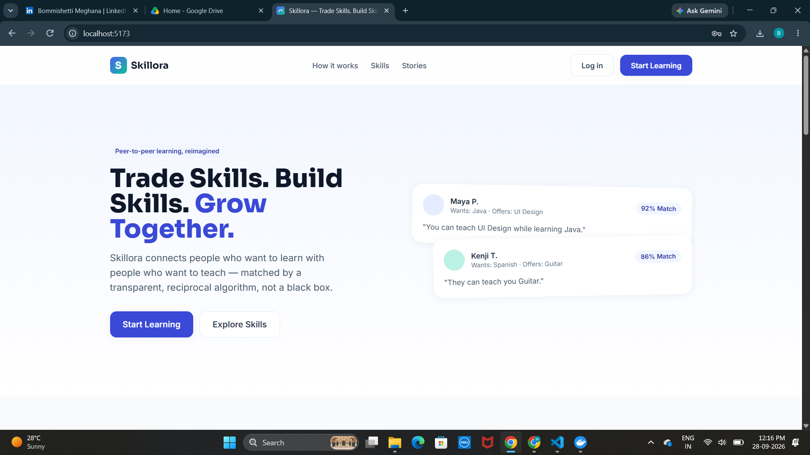 | **Login**<br>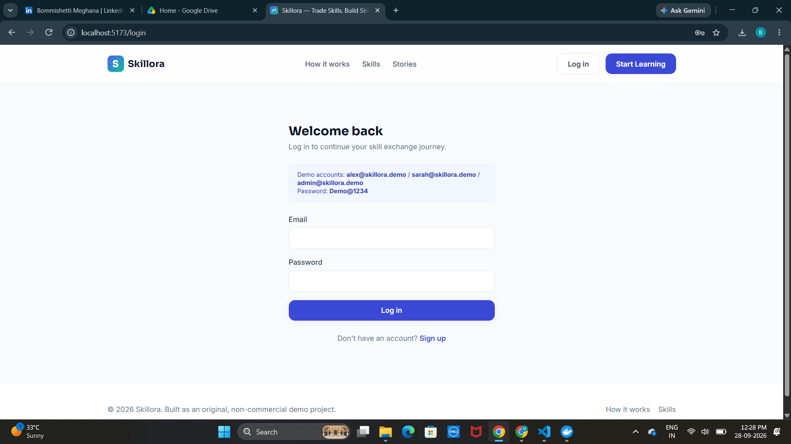 |
| **Register**<br>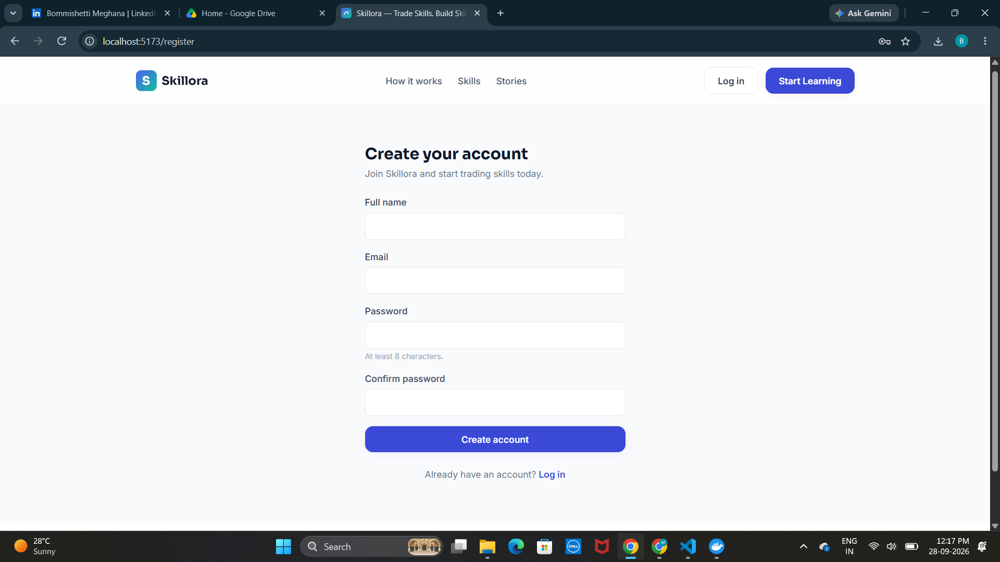 | **Dashboard**<br>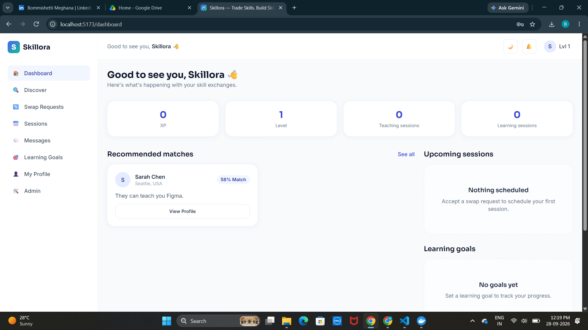 |
| **Discover**<br>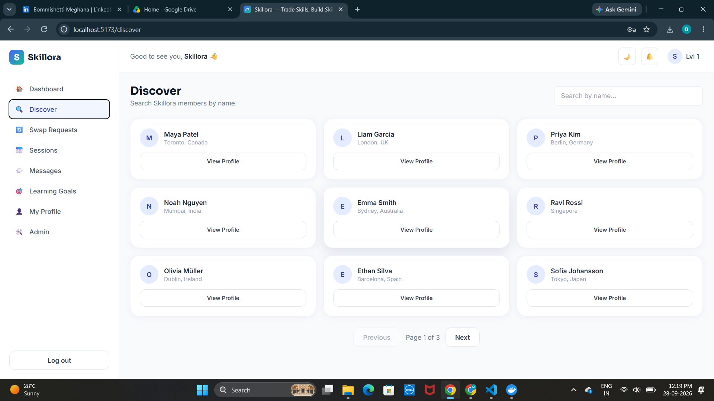 | **Swap requests**<br>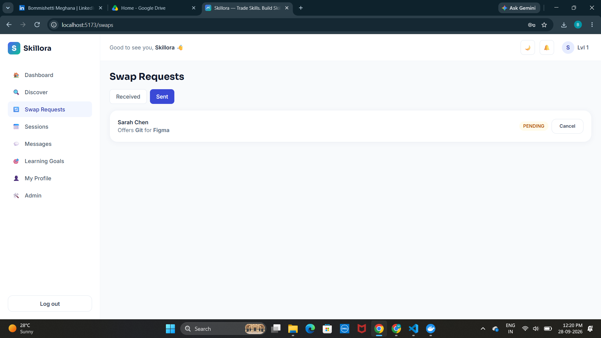 |
| **Sending a request**<br>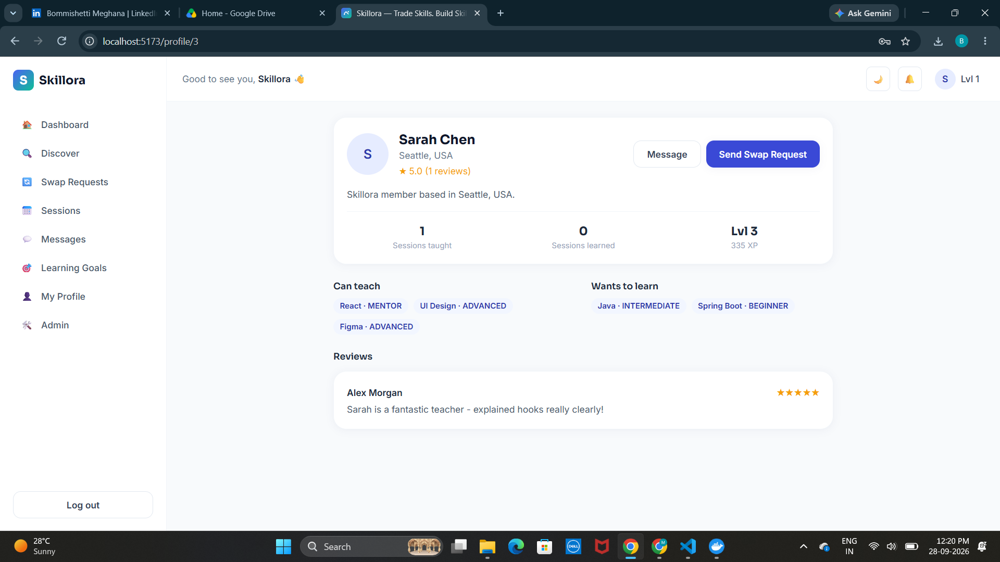 | **Sessions**<br>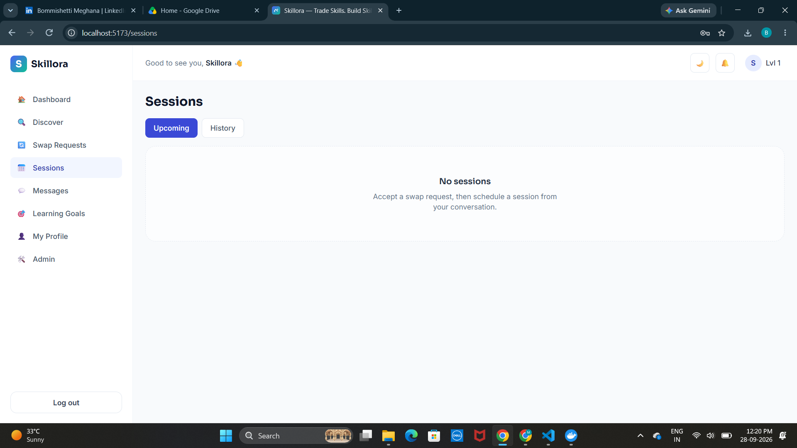 |
| **Messages**<br>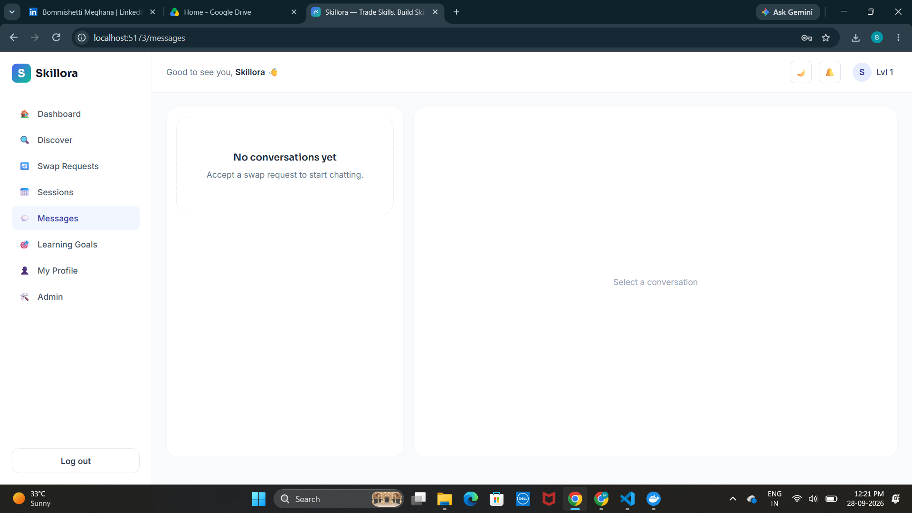 | **Learning goals**<br>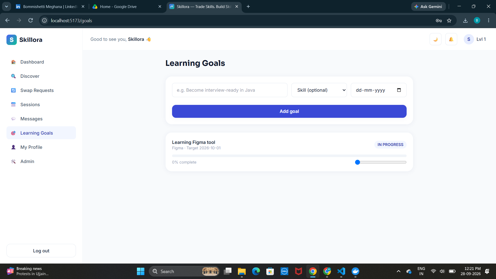 |
| **Notifications**<br>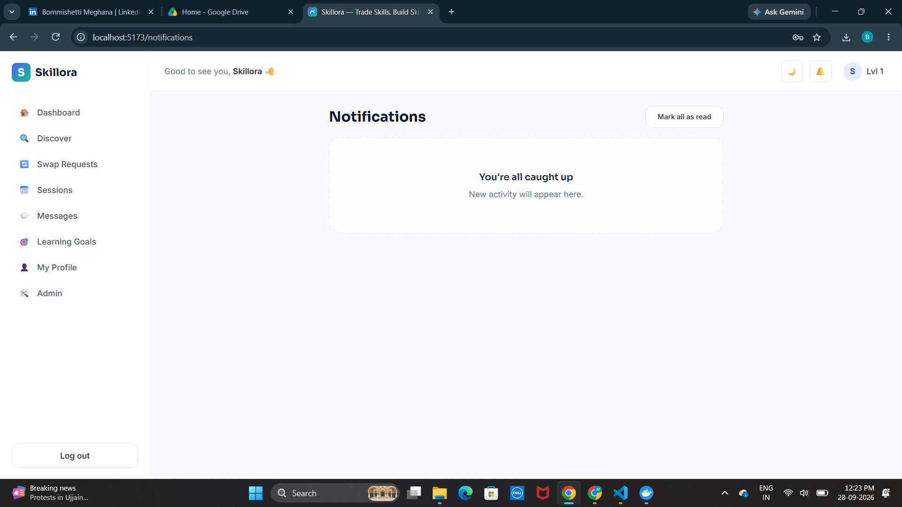 | **Dark mode**<br>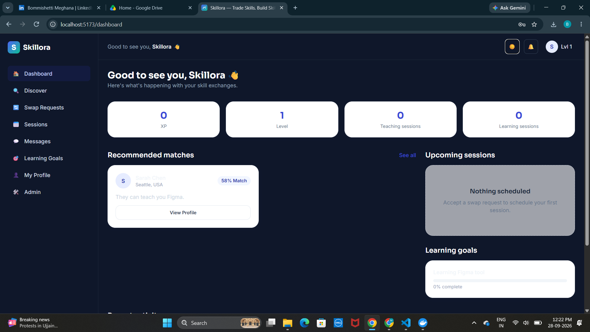 |
| **Admin dashboard**<br>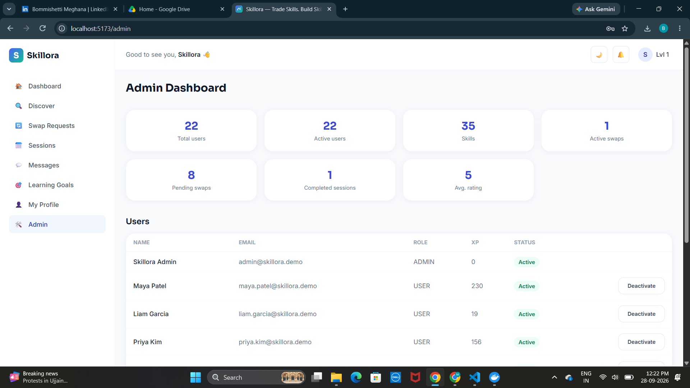 | |

There's also a full walkthrough in [docs/Demo_video.mp4](docs/Demo_video.mp4).

## What it does

- **Accounts and roles.** Register and log in with JWT auth and BCrypt-hashed passwords. Two roles: `USER` and `ADMIN`.
- **Onboarding.** Six steps, all skippable: profile, skills to teach, skills to learn, experience, availability, goal.
- **Skills catalogue.** 35 seeded skills across 10 categories.
- **Matching.** Every candidate gets a score out of 100, with a breakdown per signal and a one-line explanation (details below).
- **Swap requests.** Send, accept, reject or cancel. Accepting one opens a conversation between the two members.
- **Messaging.** Conversation list, message history, unread counts and read status. It uses REST polling, not WebSockets.
- **Sessions.** Request, confirm, complete or cancel. The backend only allows valid status changes, and the scheduler shows a hint when your availability overlaps with your partner's.
- **Reviews.** 1 to 5 stars after a completed session, one review per person per session. Reviews feed into the reviewee's reputation.
- **XP and levels.** Points for taking part, with five levels.
- **Notifications.** Swaps, messages, sessions, reviews and XP events, each markable as read.
- **Learning goals.** Create goals and track progress.
- **Discover.** Search members by name, paginated.
- **Admin.** Platform stats, a user list, and activate/deactivate with an audit record.
- **Extras.** Dark mode that remembers your choice, a responsive layout, and Swagger docs for the API.

### XP and levels

| Event | XP |
|---|---|
| Complete a session (both people get it) | +50 |
| Receive a 5-star review | +25 |
| Complete your profile | +20 |

| Level | 1 | 2 | 3 | 4 | 5 |
|---|---|---|---|---|---|
| **XP needed** | 0 | 100 | 250 | 500 | 1000 |

## Tech stack

| | |
|---|---|
| **Frontend** | React, Vite, Tailwind CSS |
| **Backend** | Java 21, Spring Boot 3, Spring Data JPA |
| **Security** | Spring Security, JWT, BCrypt |
| **Database** | PostgreSQL 16, Flyway migrations |
| **API docs** | OpenAPI / Swagger UI |
| **Tests** | JUnit and Spring Boot Test, running on in-memory H2 |
| **DevOps** | Docker, Docker Compose, nginx |

## How it fits together

One Spring Boot backend, one PostgreSQL database, one React frontend. I kept it as a single deployable on purpose. For a project this size, splitting it into services would add overhead and nothing else.

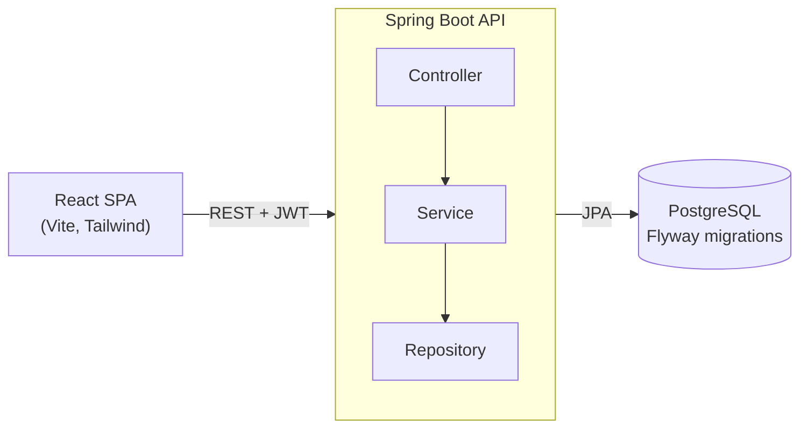

Backend packages: `controller`, `service`, `repository`, `entity`, `dto`, `mapper`, `security`, `exception`, `config`.

```
skillora/
├── backend/            Spring Boot API, Flyway migrations, tests, Dockerfile
├── frontend/           React app, nginx config, Dockerfile, vercel.json
├── docs/               API reference and demo video
├── screenshots/        Images used in this README
├── scripts/            Helper scripts
├── docker-compose.yml
└── .env.example
```

## How matching works

`MatchService` looks at each candidate and adds up six signals worth 100 points in total.

| Signal | Points | What it checks |
|---|---:|---|
| Skill compatibility | 40 | How much of what each of you wants the other can teach |
| Reciprocal potential | 20 | Full marks if you can teach each other, partial if it only goes one way |
| Experience fit | 15 | Whether the teacher's level meets what the learner is aiming for |
| Availability overlap | 10 | Words that appear in both people's free-text availability |
| Reputation | 10 | The candidate's average review rating |
| Activity | 5 | Their accumulated XP |

I went with fixed weights over anything fancier because I wanted to be able to answer "why did this person rank above that one?" just by reading the numbers. The weights are my own judgement calls, not tuned on real usage data.

## Running it

### With Docker (easiest)

You need Docker Desktop.

```bash
docker compose up --build
```

| Service | URL |
|---|---|
| Frontend | http://localhost:5173 |
| Backend API | http://localhost:8080 |
| Swagger UI | http://localhost:8080/swagger-ui/index.html |

Demo data is created on first start. To stop:

```bash
docker compose down        # stop
docker compose down -v     # stop and wipe the database
```

### Without Docker

You need Java 21, Maven 3.9+, Node 20 and PostgreSQL 16.

```bash
# 1. Create a PostgreSQL database and user, both called "skillora" (password "skillora")

# 2. Backend, runs on http://localhost:8080
cd backend
mvn spring-boot:run

# 3. Frontend, runs on http://localhost:5173 (use a second terminal)
cd frontend
cp .env.example .env
npm install
npm run dev
```

## Demo accounts

The first start seeds 21 members along with some swaps, sessions, a review and a few goals.

| Role | Email | Password |
|---|---|---|
| Admin | `admin@skillora.demo` | `Demo@1234` |
| Member | `alex@skillora.demo` | `Demo@1234` |
| Member | `sarah@skillora.demo` | `Demo@1234` |

The other seeded members use the same password.

## Tests

```bash
cd backend
mvn test
```

They run against in-memory H2 and cover registration and login, JWT-protected routes, the matching algorithm, and the full swap → session → review flow. There are no frontend tests yet.

## API

Open `/swagger-ui/index.html`, click **Authorize**, and paste the token you get from `POST /api/auth/login`. A shorter endpoint list lives in [docs/API.md](docs/API.md).

Every error comes back in the same shape:

```json
{
  "success": false,
  "message": "Human readable message",
  "timestamp": "...",
  "path": "/api/..."
}
```

## Configuration

Settings live in environment variables, and `.env.example` lists all of them with sensible defaults for local use. The two worth knowing about:

- `JWT_SECRET`: the token signing key. Change it before running anywhere other than your own machine.
- `SEED_ENABLED`: set to `false` to skip loading demo data.

## Why I built it this way

- **PostgreSQL over something looser.** Users, skills, swaps, sessions and reviews are all related to each other, so constraints, indexes and transactions earn their keep.
- **Flyway for the schema.** Local, test and production all get the same versioned changes.
- **Polling for messages.** It's much simpler to build and deploy than WebSockets, and fine at demo scale. WebSockets are on the roadmap.
- **Status rules enforced on the server.** Swaps and sessions can only move through valid states, so a misbehaving client can't put the data into a state that makes no sense.

## Security

What's in place: BCrypt password hashing, stateless JWT auth with role-based access, request validation, a uniform error format, and CORS limited to the origins you configure.

What I know is weak: the JWT sits in `localStorage`, which is easy to work with but exposed if there's ever an XSS bug (httpOnly cookies would be safer), and there's no rate limiting yet.

## Limitations and what's next

**Not built yet**

- Badges and streak XP
- A trust score breakdown and a proper skill passport page (the public profile at `/profile/{id}` is the closest thing today)
- Discover filters beyond name search
- Admin UI for managing skills, reports and announcements (skill create/edit/delete exists as an API only)
- Email notifications, session reminders, WebSockets, frontend tests

**Known limits**

- Matches are scored in memory on every request. That's fine for a demo, and it's the first thing I'd fix at scale.
- Availability overlap is a plain word comparison, not real calendar logic.

**Roadmap**

- [ ] Rate limiting and httpOnly cookie auth
- [ ] Structured availability with calendar integration
- [ ] Semantic skill matching
- [ ] WebSocket messaging and email notifications
- [ ] Session reminders and video calls
- [ ] Frontend unit and end-to-end tests

## Author

**Meghana Bommishetti** · [GitHub](https://github.com/meghana5226) · [LinkedIn](https://www.linkedin.com/in/bommishetti-meghana-0a3875289/)
